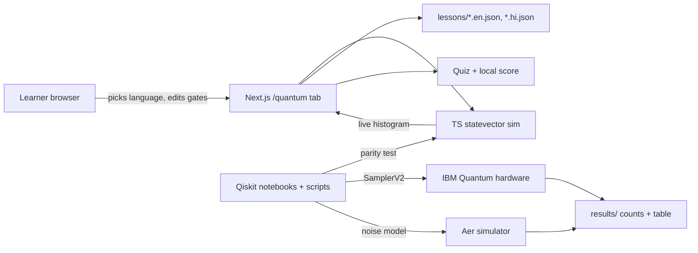

# QFF 2026 Hackathon — Plan of Action

**Team:** SusInBinary · **Track:** Education · **Case Study 3:** Quantum-ready learning for every student
**Hard deadline:** Thu 26 Nov, 23:59 IST (target: submit by 18:00)
**Midpoint review:** Thu 26 Nov, 16:30 IST (top 20 get a 15-min mentor sprint; feedback only)
**Finalists announced:** Fri 27 Nov, 08:00 IST · **Grand finals:** 09:30 (5 min pitch + 3 min Q&A) · **Awards:** 12:00

## 1. Decisions (made so we don't debate them later)

| Question | Decision | Why |
| --- | --- | --- |
| Whole-site quantum revamp? | **Defer.** Build a standalone QuantumLab app now; link it from susinbinary.com later. | Judges score the repo, demo and video. A full redesign scores 0 points. The revamp is Phase 4, after submission. |
| What do we build? | **QuantumLab**: multilingual interactive lessons. The learner changes a gate and the measurement histogram updates live. | Matches the "Your Challenge" and "Quantum Approach" boxes exactly. |
| Concepts | 3 lessons: **Superposition (H)**, **Entanglement (Bell)**, **Grover (2-qubit)** | Brief asks for 3 guided lessons with quizzes. Each maps to Day 1/Day 2 workshop notebooks (`QFF-2026-Quantum-for-Humanity`). |
| Languages | **English + Hindi** (required: 2+). Add a 3rd (Kannada/Tamil/Marathi) only if finished early. | Content lives in JSON, so each language is just another file. |
| Live histogram | **Tiny TypeScript statevector simulator in the browser** (1–3 qubits, about 60 lines). | Instant updates, works offline, deploys free on Vercel or Render. Python can't run inside Next.js. |
| "Real Qiskit circuits" | Each lesson ships a **Qiskit notebook/script**. A **parity test** asserts that Qiskit Aer and the TS simulator give the same probabilities. | Judges want correct Qiskit use and reproducibility (30%). The parity test proves the web demo is not fake. |
| Hardware | Run Bell + Grover once on **IBM Quantum hardware via Runtime `SamplerV2`**. Save the counts and compare them with the noise-model simulation. | "Strongly recommended" row, and it feeds the innovation/honesty score. |
| Repo | **Separate public repo** `qiskit-fall-fest-26-quantumlab`, MIT licence, created now. This folder is only the planning scratchpad. Copy `PLAN.md`/`README.md` into the new repo's first commit. | This repo has `.env.local`, DB/auth/cron/AdSense and unaudited history, so it is risky to publish. A fresh repo is easier to judge and run, and its history proves the code was written in the 48 hours. |
| Code-written-in-48h rule | All code goes in the new repo. Commit early and often. Pre-existing workshop notebooks are credited, not claimed. | Git history is the evidence. |

## 2. Rubric → what earns the points

| Weight | Criterion | What we ship |
| --- | --- | --- |
| 30% | Technical rigor & Qiskit code | Pinned `requirements.txt`; 3 circuits; parity test; depth/gate-count table from `transpile`; `SamplerV2` on hardware; error-mitigation notes (dynamical decoupling, Pauli twirling, `resilience_level`); README with run steps |
| 25% | Humanitarian impact | Hindi + English, no GPU or hardware needed, low-math wording, works on a phone. Evidence from 3+ real learners (pre/post quiz). Honest deployment path: teachers, offline PWA, community translators |
| 25% | Innovation & feasibility | Live gate-swap → histogram. **Classical baseline:** numpy statevector (same answers) and a static text lesson vs our interactive lesson. Honest limits: a 2-qubit Grover does not beat classical search |
| 20% | Pitch | 3-min video, 1-slide architecture diagram, working live demo, rehearsed Q&A |

## 3. Architecture (1 slide)



## 4. Folder layout

```
qiskit-fall-fest-hackathon-26/
  PLAN.md                 this file
  README.md               problem, approach, how to run, results (judged)
  requirements.txt        pinned versions (create on day 1: pip freeze | grep -E "qiskit|numpy|matplotlib")
  qiskit/                 lesson circuits (.py + .ipynb), run_hardware.py, parity_test.py
  lessons/                lesson-1-superposition.{en,hi}.json, lesson-2-..., lesson-3-...
  results/                hardware + noise-model counts (json), comparison table, depth stats
  docs/                   architecture.png, pitch-script.md, learner-test.md, screenshots
  web/                    standalone Next.js app: sim.ts, GateEditor, Histogram, Quiz, app/page.tsx
```

Lesson JSON shape (one file per language, same keys):
`{ id, title, intro, steps:[{text, circuit:[{gate,qubit,control?}], tryThis}], quiz:[{q, options, answer, why}] }`

## 5. Timeline (IST). Tue 24 Nov evening → Thu 26 Nov

### Tue 24 Nov, tonight (about 3 h)
- [ ] Form team (3–5), register team name + track in the form, create a Discord/WhatsApp channel
- [ ] Assign roles (see §6)
- [ ] Pin versions, create venv, confirm `qiskit`, `qiskit-aer`, `qiskit-ibm-runtime` run
- [ ] Confirm the IBM Quantum token works. **Queue the first hardware job tonight**, since queues are the biggest schedule risk
- [ ] Add `LICENSE` (MIT) and `.gitignore` (with `.env`) before anything else
- [ ] Create the new public repo (MIT, no env files), push `PLAN.md` + `README.md` as the first commit
- [ ] Skeleton: `web/` Next.js app and `web/sim.ts`

### Wed 25 Nov (full day). Build
| Time | Goal |
| --- | --- |
| 09:00–12:00 | `sim.ts` + gate editor + histogram working for H, X, Z, CNOT. Lesson 1 end to end in English |
| 12:00–15:00 | Lessons 2 and 3 in English; quizzes; Qiskit script per lesson; parity test passing |
| 15:00–18:00 | Hindi translation (native speaker reviews, not machine only); language switcher; mobile layout |
| 18:00–21:00 | Hardware runs (Bell, Grover) + noise-model sim; save `results/`; write the comparison table |
| 21:00 | **Feature freeze.** Everything after this is polish, not features |

### Thu 26 Nov. Prove and ship
| Time | Goal |
| --- | --- |
| 08:00–11:00 | Learner test with 3+ people (5-q pre/post quiz, 10 min each). Record scores in `docs/learner-test.md` |
| 11:00–14:00 | README, architecture diagram, limitations + next steps, depth stats, error-mitigation notes |
| 14:00–16:00 | Deploy; record 3-min video; be ready for the 16:30 mentor sprint with the working demo + 3 questions |
| 16:30–17:00 | Mentor sprint, then apply the feedback |
| 17:00–18:00 | Final pass through the submission checklist. **Submit by 18:00** |
| 18:00–23:59 | Buffer only. Fix a broken link, don't add features |

### Fri 27 Nov (if finalist)
- 08:00 check Discord/email · 09:30 live pitch (5 + 3 Q&A). Rehearse Wed/Thu night, with a local copy of the demo in case the wifi fails.

## 6. Roles (merge if the team is 3)
1. **Quantum lead:** Qiskit circuits, parity test, hardware runs, mitigation notes
2. **Frontend lead:** `sim.ts`, gate editor, histogram, quiz UI
3. **Content/i18n lead:** lessons, quizzes, Hindi (and 3rd language) with a native reviewer
4. **Impact/pitch lead:** learner test, README, video, diagram, Q&A prep
5. *(optional)* **QA/DevOps:** deploy, mobile, accessibility, the submission checklist

## 7. Submission checklist (from the brief)

**Required**
- [ ] Public GitHub repo with open-source licence (MIT)
- [ ] README: problem, approach, how to run, results
- [ ] Runnable Qiskit code or notebook
- [ ] Classical baseline + comparison table
- [ ] 3-minute pitch video link
- [ ] Team name, members and track entered in the form

**Strongly recommended**
- [ ] Architecture diagram (1 slide), export from §3
- [ ] Results from real IBM Quantum hardware or a noise-model simulation
- [ ] Error-mitigation notes + circuit-depth stats
- [ ] Honest limitations and next steps
- [ ] Pinned Qiskit and package versions
- [ ] Submit early, not at 23:59

## 8. Deliverable acceptance (definition of done)
- 3 lessons × 2 languages, each with a ≥3-question quiz
- Changing a gate in the UI updates the histogram within one frame
- `python qiskit/parity_test.py` passes (Qiskit Aer vs TS sim, tolerance ≈ 0.03 at 4096 shots)
- `results/` has hardware counts with backend name, date, shots, transpiled depth
- Fresh-clone run in under 5 commands (README verified by a teammate)

## 9. Risks

| Risk | Mitigation |
| --- | --- |
| IBM hardware queue is long | Submit jobs tonight and Wed morning; use the least busy backend; fall back to a noise-model of that backend (`NoiseModel.from_backend`) and state that honestly |
| Secrets in a public repo | The new repo starts clean. Keep `.env` out (`.gitignore` first), commit only `.env.example`, and never paste the IBM token into a notebook. Run gitleaks before the final push |
| "Code written in 48h" challenge | New repo, first commit during the event; credit workshop notebooks and libraries in README |
| Scope creep into the site revamp | Revamp is Phase 4. No restyling before submission |
| Inflated claims | State plainly: 1–3 qubit demos teach concepts; no quantum advantage claimed. The brief rewards honesty |
| Hindi quality | Native reviewer on all lesson text; keep sentences short; keep gate names (H, CNOT) untranslated |

## 10. Phase 4: after submission, full "quantum-only" site revamp
Out of scope until the deadline has passed. First step: deploy QuantumLab at `quantum.susinbinary.com` (or link it from the site header). Starting points in the susinbinary repo: `.bob/artifacts/*revamp*.html` mockups, `components/quantum-scene.tsx`, `components/hero.tsx`. Idea: move the Sus-in-Binary content under a single `/decode` section and make QuantumLab the home page.

## 11. 3-minute pitch skeleton
1. 0:00 **Problem:** quantum learning is English, math-heavy and hardware-gated (10 s of a learner story)
2. 0:25 **Demo:** switch to Hindi → drag H onto qubit 0 → histogram splits 50/50 → add CNOT → Bell state
3. 1:30 **Under the hood:** the architecture slide, Qiskit parity test, real-hardware vs noise-model table
4. 2:15 **Evidence:** pre/post learner scores (n≥3)
5. 2:40 **Honest limits + next steps**, and who benefits (teachers, regional-language students)
