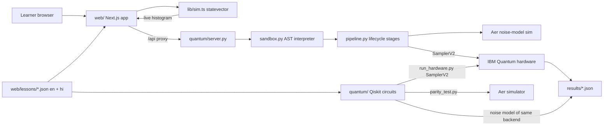

# QuantumLab: Quantum-ready learning for every student

QFF 2026 · Track: Education · Case Study 3 · Team: **SusInBinary**

> Status: work in progress. Sections marked TODO are filled in as we run things. We don't claim anything we haven't run. Plan: [PLAN.md](PLAN.md).

## Problem
Quantum education is mostly English, math-heavy and tied to expensive hardware. Learners in many regions and languages are left out.

## Approach
QuantumLab teaches three core ideas as guided lessons with quizzes, in **English and Hindi**:

1. **Superposition** (H gate)
2. **Entanglement** (Bell pair: H + CX)
3. **Grover search** (2 qubits, 1 round)

**Code tab (`/code`):** the learner writes real Qiskit and the **server** walks it through the IBM circuit lifecycle: build & compose, decompose, optimize (levels 0-3 compared), transpile for a device, execute, and post-process (ideal vs measured, total variation distance). Execution goes to a noise-model simulator of a 5-qubit device, or to **IBM Quantum hardware** through the Runtime `SamplerV2` when the server has an API key and `ENABLE_HARDWARE=1`.

The learner adds or removes gates (H, X, Z, CX, CZ) and the measurement histogram updates instantly. It runs in the browser, so it needs no hardware, no install and no heavy maths.

The lessons are single JSON files in [`web/lessons/`](web/lessons). **Both** the Qiskit scripts and the browser simulator read them, and each is tested against the same expected probabilities. That is how we know the live demo agrees with real Qiskit.



## How to run

Needs Node 20+ and Python 3.11+.

```bash
# 1. Qiskit side (from the repo root)
python3.11 -m venv .venv && source .venv/bin/activate
pip install -r requirements.txt
python quantum/parity_test.py                # Qiskit exact + Aer vs expected probabilities
python quantum/test_pipeline.py              # Code tab backend: sandbox + 6 lifecycle stages
python quantum/server.py                     # Qiskit API on 127.0.0.1:8000 (keep running)

# 2. Web app (second terminal)
cd web && npm install && npm run dev        # http://localhost:3000  (/code needs step 1's server)
npm test                                     # browser simulator vs expected probabilities

# 3. Real hardware (needs an IBM Quantum API key)
cp .env.example .env                         # QUANTUM_API_KEY=..., and ENABLE_HARDWARE=1 to allow it in the Code tab
python quantum/run_hardware.py               # saves results/<lesson>.json
```

### Security of the Code tab
Learner code is **never** passed to `exec` or `eval`. `quantum/sandbox.py` parses it with `ast` and interprets only a whitelist (QuantumCircuit, gate methods, compose/append, `range` loops, numeric maths), with caps on qubits (5), loop size, statements and circuit size. `test_pipeline.py` checks that 14 attack patterns (imports, `open`, `exec`, dunder access, comprehensions, `while`, huge loops) are rejected. Hardware jobs are off by default, run one at a time, and the IBM key stays on the server (the browser only talks to the `/api` proxy).

Versions are pinned in [`requirements.txt`](requirements.txt) (Qiskit 2.6.2, Aer 0.18.4, IBM Runtime 0.52.1) and `web/package.json`.

## Results

Verified so far (simulator only):

| Lesson | Qubits | Logical depth | Gates | Qiskit = browser simulator |
| --- | --- | --- | --- | --- |
| Superposition | 1 | 1 | 1 | yes |
| Entanglement | 2 | 2 | 2 | yes |
| Grover (2 qubits) | 2 | 6 | 10 | yes |

TODO: hardware vs noise-model counts, transpiled depth (`results/`), classical baseline comparison, learner test (pre/post).

## Error mitigation
`quantum/run_hardware.py` turns on dynamical decoupling and gate Pauli twirling in the Runtime `SamplerV2` and transpiles at `optimization_level=3`. TODO: record the measured effect.

## Limitations and next steps
- The browser simulator is exact and noiseless, and supports up to a few qubits with real amplitudes only (H, X, Z, CX, CZ).
- Grover with 4 items shows the idea, not a speedup. We claim no quantum advantage.
- Hindi text needs review by more native speakers. More languages are just more JSON.

## Credits
Qiskit, Qiskit Aer, Qiskit IBM Runtime, Next.js, Tailwind CSS. The look follows [susinbinary.com](https://susinbinary.com). Day 1/Day 2 workshop notebooks from QFF 2026 informed the circuits but are not part of this repo.

## Licence
MIT, see [LICENSE](LICENSE).
