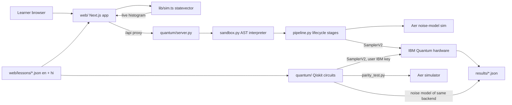

# QuantumLab: Quantum-ready learning for every student

QFF 2026 · Track: Education · Case Study 3 · Team: **SusInBinary**

**Live demo:** https://quantumlab-fawn.vercel.app (also at https://quantum.susinbinary.com once DNS finishes) · Code tab API: https://quantumlab-api.onrender.com

> The Code tab API runs on a free Render instance that sleeps when idle. The first run after a quiet period can take about a minute. Hardware runs on the hosted site use the visitor's own IBM key (used for that single run, never stored or logged). Without a key the demo runs on the noise-model simulator.

> Status: work in progress. Sections marked TODO are filled in as we run things. We don't claim anything we haven't run. Plan: [PLAN.md](PLAN.md).

## Problem
Quantum education is mostly English, math-heavy and tied to expensive hardware. Learners in many regions and languages are left out.

## Approach
QuantumLab teaches three core ideas as guided lessons with quizzes, in **English, Hindi (हिन्दी) and Kannada (ಕನ್ನಡ)**:

1. **Superposition** (H gate)
2. **Entanglement** (Bell pair: H + CX)
3. **Grover search** (2 qubits, 1 round)

**Code tab (`/code`):** the learner writes real Qiskit and the **server** walks it through the IBM circuit lifecycle: build & compose, decompose, optimize (levels 0-3 compared), transpile for a device, execute, and post-process (ideal vs measured, total variation distance). Execution goes to a noise-model simulator of a 5-qubit device, or to **real IBM Quantum hardware** through the Runtime `SamplerV2`: choose *IBM Quantum hardware*, paste your own IBM API key, run. The server picks the least busy device, turns on dynamical decoupling and Pauli twirling, then replays the same transpiled circuit on that device's noise model. The page shows ideal vs real hardware vs noise model side by side, and a **Download results (JSON)** button saves the full report (backend, job id, counts, depth, TVD) for the README and the pitch.

The learner adds or removes gates (H, X, Z, CX, CZ) and the measurement histogram updates instantly. It runs in the browser, so it needs no hardware, no install and no heavy maths.

The lessons are single JSON files in [`web/lessons/`](web/lessons). **Both** the Qiskit scripts and the browser simulator read them, and each is tested against the same expected probabilities. That is how we know the live demo agrees with real Qiskit.



## Deployment

| Part | Host | How |
| --- | --- | --- |
| `web/` Next.js app | Vercel (project root directory `web`) | `vercel deploy --prod`; env `QISKIT_API_URL` points at the API |
| `quantum/server.py` Qiskit API | Render free web service | `render.yaml` (build `pip install -r requirements.txt`, start `python quantum/server.py`, health `/api/health`) |

## How to run

Needs Node 20+ and Python 3.11+.

```bash
# 1. Qiskit side (from the repo root)
python3.11 -m venv .venv && source .venv/bin/activate
pip install -r requirements.txt
python quantum/parity_test.py                # Qiskit exact + Aer vs expected probabilities
python quantum/baseline.py                   # classical baseline table
python quantum/test_pipeline.py              # Code tab backend: sandbox + 6 lifecycle stages
python quantum/server.py                     # Qiskit API on 127.0.0.1:8000 (keep running)

# 2. Web app (second terminal)
cd web && npm install && npm run dev        # http://localhost:3000  (/code needs step 1's server)
npm test                                     # browser simulator vs expected probabilities

# 3. Real hardware: open the Code tab, pick "IBM Quantum hardware", paste your IBM API key, Run.
#    (Optional, your own private server: put QUANTUM_API_KEY and ENABLE_HARDWARE=1 in .env and the key field can stay empty.)
python quantum/test_hardware.py              # hardware path against a fake 127-qubit device, no key needed
```

### Security of the Code tab
Learner code is **never** passed to `exec` or `eval`. `quantum/sandbox.py` parses it with `ast` and interprets only a whitelist (QuantumCircuit, gate methods, compose/append, `range` loops, numeric maths), with caps on qubits (5), loop size, statements and circuit size. `test_pipeline.py` checks that 14 attack patterns (imports, `open`, `exec`, dunder access, comprehensions, `while`, huge loops) are rejected. Hardware runs need the visitor's own IBM key, run one at a time, give up after 20 minutes in the queue, and the key is used for that one run only: it is never saved, put in the job record, logged, or included in the downloaded report (`test_hardware.py` checks this), and errors are scrubbed of it.

Versions are pinned in [`requirements.txt`](requirements.txt) (Qiskit 2.6.2, Aer 0.18.4, IBM Runtime 0.52.1) and `web/package.json`.

## Results

Verified so far (simulator only):

| Lesson | Qubits | Logical depth | Gates | Qiskit = browser simulator |
| --- | --- | --- | --- | --- |
| Superposition | 1 | 1 | 1 | yes |
| Entanglement | 2 | 2 | 2 | yes |
| Grover (2 qubits) | 2 | 6 | 10 | yes |

### Classical baseline vs quantum

`python quantum/baseline.py` (seeded, 4096 shots, quantum column = noise model of the 127-qubit `FakeSherbrooke`, optimization level 3). TVD = total variation distance to the ideal histogram (lower is better). The classical program is the simplest one that produces the same histogram: a coin flip, a shared coin copied to both bits, or a random guess for Grover. Depths include the final measurement.

| Lesson | Classical TVD | Quantum (noise model) TVD | Logical depth | Transpiled depth | Oracle queries classical / quantum |
| --- | --- | --- | --- | --- | --- |
| superposition | 0.013 | 0.001 | 2 | 4 | n/a |
| entanglement | 0.004 | 0.016 | 3 | 6 | n/a |
| grover | 0.751 | 0.025 | 7 | 18 | 2.25 / 1 |

Reading it honestly: for superposition and entanglement a classical program reproduces the histogram just as well (the lessons teach the concept, not an advantage). Grover finds the marked item with 1 oracle query where classical search needs 2.25 on average for 4 items, but that is a toy size and is not a practical speedup.

TODO: real-hardware run (use the Code tab's *Download results* file, commit it under `results/`) and the learner test (pre/post).

## Error mitigation
Hardware runs in the Code tab turn on dynamical decoupling and gate Pauli twirling in the Runtime `SamplerV2`, and the optimization level is chosen by the learner (level 3 gives the shallowest circuit). The report compares hardware against a noise-model replay on the same device. TODO: record the measured effect from a real run.

## Limitations and next steps
- The browser simulator is exact and noiseless, and supports up to a few qubits with real amplitudes only (H, X, Z, CX, CZ).
- Grover with 4 items shows the idea, not a speedup. We claim no quantum advantage.
- Hindi and Kannada text needs review by native speakers before the final submission. The whole UI (both tabs, every lifecycle stage and every server message) is translated, but the Qiskit code in the editor stays in English because it is Python. More languages are one dictionary in `web/lib/dicts.ts` plus one block per lesson JSON; `npm test` fails if any key or lesson is missing a language.

## Credits
Qiskit, Qiskit Aer, Qiskit IBM Runtime, Next.js, Tailwind CSS. The look follows [susinbinary.com](https://susinbinary.com). Day 1/Day 2 workshop notebooks from QFF 2026 informed the circuits but are not part of this repo.

## Licence
MIT, see [LICENSE](LICENSE).
